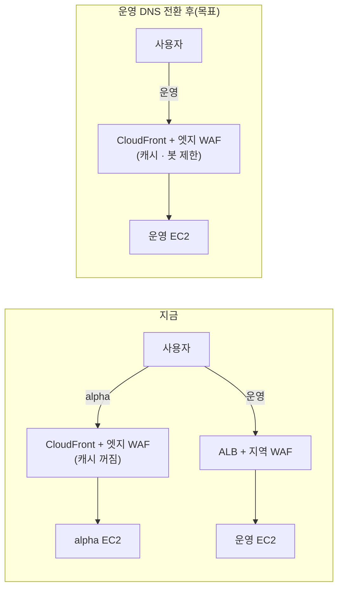

# 앞단(CloudFront · WAF · 캐시) — 현재 상태, 캐시 설계, 운영 전환 런북

> **상태(2026-11-21): 운영은 아직 ALB 로 가요. CloudFront 로 옮기기 전이에요.**
> alpha 는 이미 CloudFront 를 거치지만, 운영 DNS(`teameet.co.kr` · `www`)는 지금도 ALB 를 가리켜요.
> 운영 CloudFront 배포는 만들어 두었고 캐시까지 켜서 시험을 마쳤지만 **운영 사용자의 요청은 0건**이에요.
> 아래 「전환 후」 설명은 목표 구조이고, 전환이 끝나면 이 상태 박스를 고쳐요.

이 값들은 **이 저장소 코드로 바꿀 수 없어요.** 저장소에 앞단 IaC 가 없고(terraform/cdk/cfn 0건) 배포 스크립트도
앞단을 건드리지 않아요 — AWS 쪽 수동 작업이에요. 그래서 설정이 바뀌면 이 문서를 같이 고쳐요.

---

## 1. 지금 어디까지 왔나

| 항목 | alpha | 운영 |
|---|---|---|
| DNS | `alpha` → CloudFront(A · AAAA 별칭) | **apex · `www` → ALB(A 별칭)** — CloudFront 로 옮기기 전 |
| 앞단 | CloudFront + 엣지 WAF | **ALB + 지역 WAF** (CloudFront 배포는 대기 중) |
| CloudFront 캐시 | **꺼짐**(기본 동작 `Managed-CachingDisabled`) | **켜짐**(3절) — 그러나 DNS 가 안 가서 요청 0 |
| 봇 속도 제한 | 엣지 WAF 의 Count 규칙(운영 전환 전이라 alpha 요청만 셈) | 같은 엣지 WAF — 전환 뒤부터 운영 요청을 셈 |
| 오리진 응답 대기 | 60초 | 60초(ALB `idle_timeout` 도 60초) |
| 서버 보안그룹 | 443 은 CloudFront 오리진 대역(관리형 prefix list)만, 80 닫힘 | 같음 + ALB 보안그룹에서 오는 443 |

- **엣지 WAF 는 alpha 와 운영 CloudFront 배포가 함께 써요.** 규칙을 넣을 때 alpha 영향도 같이 봐요(4절).
- 캐시 설정은 **운영 배포에만** 넣었고 alpha 는 그대로예요. 운영 배포는 요청이 0건이라
  `--resolve`(DNS 를 우회해 CloudFront 주소로 직접 요청)로 시험했어요.



## 2. 왜 ALB 를 빼나

| | ALB 를 둠 | CloudFront 가 서버로 직행 |
|---|---|---|
| 서버가 한 대일 때 | 나눠 줄 곳이 없어요. 경로 규칙도 없고, 상태 검사는 API 만 봐서 웹이 죽은 것은 몰라요 | 같은 일을 해요 |
| 고정비 | ALB 시간·용량 + 전용 공인 IP 2개 + 지역 WAF(엣지 WAF 와 같은 규칙) — 합쳐 월 수십 달러 | 엣지 WAF 하나만 |
| 서버가 죽으면 | 502 를 그대로 봐요 | CloudFront 사용자 지정 오류 페이지(503 안내)가 떠요 |
| 서버가 2대 이상이 되면 | 필요해요 | **ALB 를 다시 만들어야 해요**(코드로 관리하지 않아 손으로 20~30분) |

ALB 는 **같은 역할의 서버가 2대 이상일 때** 필요한 물건이에요. 서버를 늘리게 되면 CloudFront 뒤에 다시 둬요.
단점도 있어요 — 앞단 설정이 AWS 콘솔에만 있어서(코드로 안 남음) 이 문서가 유일한 기록이에요.

## 3. 캐시 설계 (운영 CloudFront 배포에 켜 둔 상태)

### 3.1 전제 — 코드로 확인한 것

| 질문 | 답 | 근거 |
|---|---|---|
| 서버가 그리는 HTML 이 로그인 쿠키에 따라 달라지나 | **아니요** | `apps/v1_web/src` 에 `next/headers`(쿠키·헤더 읽기) import 0건. 로그인한 사람의 내용은 브라우저가 API 로 채워요 |
| HTML 응답이 쿠키를 심나 | 아니요 | 캐시된 응답에 `set-cookie` 없음(시험) |
| 주소 꼬리 `?from=` 이 내용을 바꾸나 | **네** | 뒤로가기 링크용으로 `useSearchParams().get('from')` 을 20곳 넘게 써서 서버 렌더 때 링크 주소에 들어가요 |
| 봇과 사람의 HTML 이 다른가 | 네 | `next.config.ts` `htmlLimitedBots` — 봇에게는 head 를 먼저 끝낸 HTML |
| 같은 주소가 HTML 과 화면 조각(RSC)을 둘 다 내나 | 네 | 응답 `vary: rsc, next-router-state-tree, next-router-prefetch, next-router-segment-prefetch` |

그래서 **사람에게는 `from` 을 캐시 키에서 빼지 않아요**(빼면 다른 사람이 연 뒤로가기 링크가 담긴 HTML 을 받아요).
대신 **봇 UA 일 때만** 엣지에서 `from` 을 지워요(봇은 뒤로가기를 쓰지 않아요).

### 3.2 캐시 동작 (위에서부터 먼저 맞아요)

| 경로 | 캐시 정책 | 수명 | 캐시 키 |
|---|---|---|---|
| `/_edge/*` | `CachingOptimized` | — | 오류 안내 페이지(S3) |
| `/api/*` · `/socket.io*` · `/admin*` · `/tournament-ops*` · `/sw-push.js` | `CachingDisabled` | 0 | 모든 헤더·쿠키·쿼리를 오리진에 전달 |
| `/_next/static/*` · `/uploads/*` | `teameet-prod-immutable` | 오리진 따름(1년 immutable) | Host + 쿼리 전체 |
| `/_next/image*` | `teameet-prod-next-image` | 오리진 따름(최대 7일) | Host + `Accept`(webp/avif 구분) + 쿼리 전체 |
| `*.png` `*.jpg` `*.jpeg` `*.webp` `*.avif` `*.gif` `*.ico` `*.svg` · `/fonts/*` | `teameet-prod-public-assets` | 5분(오리진은 `no-cache`) | Host + 쿼리 전체 |
| 기본(공개 HTML) | `teameet-prod-html-60s` | **60초 고정**(오리진 `no-store` 를 이 정책만 무시) | Host + `User-Agent` + `RSC` · `Next-Router-State-Tree` · `Next-Router-Prefetch` · `Next-Router-Segment-Prefetch` · `Next-Url` + 쿼리 전체, 쿠키 없음 |

- 오리진 요청 정책은 모든 동작에서 `Managed-AllViewer`(헤더·쿠키·쿼리를 오리진에 그대로 줘요 — 전환 전과 같아요).
- **관리형 캐시 정책을 못 쓴 이유**: `Host` 를 캐시 키에 넣어야 해서예요. 빼면 `www` 의 301 이 apex 에 섞여 무한 이동이 날 수 있어요.
- HTML 키에 `User-Agent` 를 넣은 이유: 봇용·사람용 HTML 이 달라서예요. 봇은 UA 가 고정이라 적중률이 높고, 사람은 같은 주소를 1분 안에 다시 여는 일이 적어(로그상 사람 HTML 적중 약 7%) 잃는 것이 작아요.
- RSC 헤더를 키에 넣은 이유: 같은 주소의 화면 조각(`text/x-component`)이 HTML 자리에 나가면 화면이 깨져요.
- 브라우저 쪽은 바뀌지 않아요: 캐시된 HTML 도 `cache-control: no-cache, no-store, must-revalidate` 를 그대로 내보내요.
- 응답 헤더 정책은 만들지 않았어요 — 보안 헤더는 nginx 가 붙이고 CloudFront 가 그대로 통과시켜요(캐시된 응답에서도 확인).

### 3.3 CloudFront Function · 오류 캐시

- **`teameet-prod-bot-strip-from`** (기본 동작, viewer-request): UA 가 GPTBot · ClaudeBot · Claude-SearchBot · Claude-User · CCBot ·
  OAI-SearchBot · ChatGPT-User · PerplexityBot · Perplexity-User · Applebot · meta-externalagent · Bytespider · Amazonbot ·
  Googlebot · bingbot · Yeti · Daumoa · `Daum/` 이면 쿼리의 `from` 만 지워요. 다른 쿼리(`_rsc` 등)와 사람 UA 는 그대로예요.
- 오류 캐시: 400·403·404·405·414·416 은 **0초**(한 사람의 오류를 다른 사람에게 주지 않아요), 500·501·503 은 5초,
  502·504 는 10초 + 안내 페이지(503).

### 3.4 효과와 한계 (추정)

- 운영 nginx 로그 15.8시간(약 18만 건) 기준: **GPTBot 이 화면 요청의 55%** 였어요. 봇만 `from` 을 빼고 60초 캐시하면 봇 화면 요청이
  오리진에 **약 42% 덜** 가고 오리진 전체 요청은 **약 29% 줄어요**(`from` 을 안 빼면 0%). 낙관적 추정이에요 —
  캐시는 엣지 위치(POP)마다 따로라 실제 적중은 더 낮을 수 있어요.
- 봇에게 1시간 캐시를 주면 약 −88% 인데, nginx 가 화면 응답에 `no-store` 를 강제로 붙여서 **nginx 변경(약 10줄: 봇 UA 일 때만
  `s-maxage` 를 붙임)이 먼저 필요해요.** 이 변경은 아직 안 했어요.
- **효과는 운영 DNS 를 돌린 뒤부터예요.** 지금은 운영에 영향이 없어요.
- **전환 전에 정할 것**: 지금 설정이면 DNS 를 돌리는 순간 사람도 공개 HTML 을 60초 캐시로 받아요(서버가 그린 첫 화면 값이 최대 60초
  늦을 수 있어요). 걱정되면 기본 동작을 `CachingDisabled` 로 낮추고 봇 캐시는 nginx 변경 뒤에 켜요.

---

## 4. WAF — `teameet-edge-waf`

us-east-1 CLOUDFRONT 범위 웹 ACL 하나를 alpha·운영 두 배포가 공유해요. 운영 ALB 에는 규칙이 같은 **지역 WAF** 가 따로 붙어 있고,
전환이 끝나 ALB 를 지울 때 함께 지워요.

| 우선순위 | 규칙 | 동작 |
|---|---|---|
| 1 | 국가 차단 | 차단 |
| 10 · 20 · 30 · 40 | AWS 관리형 Common / KnownBadInputs / SQLi / IpReputation | 차단(아래 Count 예외 제외) |
| 45 | IP당 속도 제한 — 인증 경로(5분 300건) | 차단 |
| 50 | IP당 속도 제한 — 전체(5분 3,000건) | 차단 |
| 55 | `teameet-count-ip-1000-5m` — 같은 IP 5분 1,000건 이상 | **Count 만** |
| 56 | `teameet-count-ai-crawler-ua-300-5m` — AI 수집기 UA(소문자 비교) 별 5분 300건 이상 | **Count 만** |

- 55·56 은 2026-11-21 에 더했고 **Block 이 아니에요.** GPTBot 은 여러 IP 로 나눠 와서 IP 규칙(45·50)에 걸리지 않아 UA 별로 묶는
  규칙이 비어 있었어요. 숫자는 운영 nginx 로그로 정했어요(IP당 5분 최대 599, GPTBot UA 별 5분 중앙값 501). 검색 로봇(Googlebot · Yeti ·
  Bing · Daum)은 56 에 넣지 않았어요(검색 노출).
- 규칙 1개당 월 $1(요청료 100만 건당 $0.60 은 별도)이고 용량 단위(WCU)는 한도 1500 안이에요.

### 4.1 Count 로 남긴 관리형 세부 규칙 — Block 으로 바꾸지 말아요

관리형 규칙 안에서 **세부 규칙만** Count 로 둔 것이 있어요(`RuleActionOverrides`): Common 의 `SizeRestrictions_BODY` ·
`CrossSiteScripting_BODY`, SQLi 의 `SQLi_QUERYARGUMENTS` · `SQLiExtendedPatterns_QUERYARGUMENTS` · `SQLi_BODY`.
기록상 사진 업로드 본문과 Next.js `_rsc` 쿼리 토큰이 오탐에 걸려서예요. **Block 으로 되돌리면 사진 업로드가 깨지거나 화면 이동
(`_rsc` 요청)이 막혀요.** WAF 규칙을 손볼 때는 변경 전에 현재 상태를 저장해 두고(`get-web-acl`), 지역 WAF 와 이름·순서·한도·예외를
`diff` 로 맞대요.

### 4.2 55·56 을 Block 으로 바꾸는 기준

- **운영 트래픽이 들어온 뒤 3~7일** 관찰한 값으로만 정해요(전환 전에는 alpha 요청만 세요).
- **같은 ACL 을 alpha 가 써요.** Block 으로 바꿀 때 규칙에 호스트 범위 한정(`Host` 가 운영 도메인일 때만)을 붙여 alpha QA(반복 요청·캡처)가
  막히지 않게 해요.
- 합격 기준: Count 에 걸린 요청 중 사람 UA(브라우저 · 로그인 쿠키) 0건, 검색 로봇 0건, 링크 미리보기(카카오톡 Scrap · Facebook ·
  Slack · Twitter) 0건, 통신사 NAT 로 한 IP 에 사람이 몰리는 경우 없음, 우리가 쓰는 점검·모니터링 도구와 UA 겹침 없음.
- 하나씩 바꿔요(UA 규칙 56 이 대상이 분명해서 먼저). 응답은 429 + `Retry-After`. 바꾼 뒤 30분은 차단 건수·5xx·사람 요청을 보고,
  사람이 막히면 즉시 Count 로 되돌려요. `update-web-acl` 은 `LockToken` 이 매번 바뀌므로 직전에 `get-web-acl` 로 새로 받고, **기존
  규칙이 그대로 남는지** 변경 전후를 `diff` 해요.
- 관찰 지표: CloudWatch `AWS/WAFV2` `CountedRequests`(규칙별) · WAF 로그(us-east-1) Logs Insights · `get-sampled-requests`.

---

## 5. 오리진 인증서 전제

CloudFront 는 **오리진 인증서를 검증해요.** 서버의 Let's Encrypt 인증서가 만료·불일치하면 사용자는 즉시 502 를 봐요(안내 페이지가 떠요).

| 환경 | 갱신 | 방식 |
|---|---|---|
| prod | `teameet-prod-certbot.timer` | Route53 DNS-01 |
| alpha | `teameet-alpha-certbot.timer` | webroot |

- 점검 모드(`docs/ops/maintenance-mode.md`)가 켜져 있으면 ACME 요청도 503 을 받아요. alpha 갱신 시각과 겹치지 않게 짧게 써요.
- 만료 확인은 **서버 안에서**(SSM) 해요 — 보안그룹이 CloudFront 대역만 받아서 밖에서는 오리진에 직접 붙지 못하고, 인증서 이름도
  오리진 호스트명이 아니라 서비스 도메인이에요:
  `echo | openssl s_client -connect 127.0.0.1:443 -servername teameet.co.kr 2>/dev/null | openssl x509 -noout -enddate`
  (alpha 는 `-servername alpha.teameet.co.kr`).
- **운영 DNS 를 옮긴 뒤 첫 갱신 때 갱신 타이머가 성공했는지 꼭 확인해요.**

## 6. 60초 벽

CloudFront 는 오리진이 **60초 동안 응답 바이트를 보내지 않으면** 연결을 끊고 504 를 줘요(지금 ALB 와 같은 값). nginx 의 대진 생성
3라우트는 180초까지 기다리지만 **사용자에게 보이는 상한은 60초**예요. 원인·완화책·상향 절차는 `docs/ops/alb-idle-timeout.md`
(6절이 CloudFront 기준)에 있어요. 한도 상향(Service Quotas → CloudFront "Response timeout per origin", 180초)은 **전환 전에 신청**해 둬요.

---

## 7. 운영 DNS 전환 런북 (아직 실행 전)

> 값(호스팅 영역 ID · 배포 ID · ARN)은 AWS 에서 읽어 채워요. 모든 쓰기는 한 번에 하나, **직전 상태 저장 → 변경 → 확인 → 되돌리기 준비** 순서예요.

### 7.1 착수 전 게이트 (전부 예일 때만)

1. 운영이 실제 접속 IP 복원(nginx realip) 릴리스를 서빙해요 — 응답 `x-teameet-release` 로 확인.
2. 메모리 핫픽스가 운영에 반영되고 재시작 0 이 24시간 이상이에요.
3. 오리진 인증서가 갱신 가능해요(5절).
4. **사람용 HTML 60초 캐시를 그대로 둘지** 정했어요(3.4절). 안 두면 기본 동작을 `CachingDisabled` 로 먼저 낮춰요.
5. 엣지 WAF 규칙 7개가 지역 WAF 와 같아요(예외 내용까지 `diff`).
6. `--resolve` 시험을 다시 통과했어요(로그인 · 업로드 · 소켓 · 어드민 긴 요청 · 카카오 로그인 되돌아오기).
7. 서버 보안그룹이 CloudFront 대역만 받아요(443 prefix list, 80 닫힘).
8. 60초 한도 상향을 신청했어요(승인은 나중에 와도 돼요).

### 7.2 전환

1. Route 53 의 apex · `www` A 레코드 현재 값을 파일로 저장해요(되돌리기 재료).
2. **UPSERT** 로 두 레코드의 별칭 대상을 ALB → 운영 CloudFront 배포로 바꿔요(삭제 후 생성이 아니라 값만 바꿔 빈틈이 없어요).
   AAAA 는 첫날 넣지 않고 하루 뒤 이상이 없으면 추가해요(alpha 는 이미 AAAA 를 쓰고 있어요).
3. 확인: `dig` 가 CloudFront 주소로 풀려요 · 응답 헤더에 `via: … cloudfront` · `x-teameet-release` 일치 · `/api/v1/health` 가 매번
   `Miss` 와 200 · 정적 파일 두 번째 `Hit` · `www` 가 apex 로 301 · 로그인과 소켓이 이어져요.
4. **끊김 없음 확인**: 전환 직전부터 5분간 1초 간격으로 `/api/v1/health` 의 상태 코드를 기록하고 200 이 아닌 줄이 0 인지 봐요
   (새 연결 기준, `--no-keepalive`). 두 길(ALB · CloudFront)이 동시에 살아 있어 단말의 DNS 캐시가 남아도 요청이 실패하지 않아요.

### 7.3 되돌리기

저장해 둔 apex · `www` 별칭(ALB)을 다시 UPSERT 해요(몇 분, 데이터 영향 없음). AAAA 를 추가했다면 같이 삭제해요.
캐시만 문제면 DNS 를 되돌리지 않고 기본 동작의 캐시를 끄는 편이 가벼워요.

### 7.4 지켜본 뒤 정리 (전환 후 7일 이상)

조건: ALB 요청이 3일 연속 0 · CloudFront 5xx 가 전환 전과 같거나 낮음 · 로그인 실패율 증가 없음 · 엣지 WAF 가 운영 요청을 받고 있음 ·
**사용자 승인**. 삭제는 되돌릴 수 없어요(ALB 는 손으로 다시 만들어야 해요).

| 순서 | 할 일 |
|---|---|
| 1 | ALB 삭제 방지를 끄고, 지역 WAF 연결 해제(각각 현재 값 저장 먼저) |
| 2 | ALB 삭제(리스너·규칙은 같이 사라지고 전용 공인 IP 2개도 풀려요) |
| 3 | 대상 그룹 2개 삭제 |
| 4 | 서버 보안그룹의 「ALB 보안그룹에서 오는 443」 규칙 제거 → ALB 보안그룹 삭제(다른 자원이 쓰는지 먼저 확인) |
| 5 | 지역 WAF 웹 ACL · 로그 그룹 삭제 |
| 6 | 이 문서 · `README.md` · `alb-idle-timeout.md` 의 ALB 서술을 지우고 상태 박스를 「전환 완료」로 고쳐요 |

---

## 8. 확인 명령 (읽기 전용)

```bash
# 앞단이 무엇인지 — 운영은 전환 전이라 awselb, 전환 뒤에는 via 에 cloudfront
curl -sI --no-keepalive https://teameet.co.kr/landing | grep -i -E '^(server|via|x-cache|x-amz-cf-pop|x-teameet-)'
curl -sI --no-keepalive https://alpha.teameet.co.kr/landing | grep -i -E '^(via|x-cache|x-teameet-)'

# DNS — 운영이 ALB 를 가리키는지(전환 전) / CloudFront 인지(전환 후)
dig +short teameet.co.kr A
dig +short alpha.teameet.co.kr A

# 배포 설정(DISTRIBUTION_ID 는 list-distributions 로 찾아요)
aws cloudfront list-distributions \
  --query 'DistributionList.Items[].{id:Id,aliases:Aliases.Items,status:Status}' --output table
aws cloudfront get-distribution-config --id "$DISTRIBUTION_ID" \
  --query 'DistributionConfig.CacheBehaviors.Items[].{path:PathPattern,policy:CachePolicyId}'

# WAF (CLOUDFRONT 범위는 us-east-1 에서만 조회돼요)
aws wafv2 list-web-acls --scope CLOUDFRONT --region us-east-1 --query 'WebACLs[].Name'
```

상태를 확인하는 `curl` 은 `--no-keepalive` 로 새 연결을 써요(`docs/ops/maintenance-mode.md` "해제 확인은 반드시 새 연결로 한다").

## 관련 파일

- `deploy/nginx.conf` · `deploy/nginx.alpha.conf` — realip, 대진 생성 3라우트의 `proxy_read_timeout 180s`, 화면 응답의 `no-store` 강제
- `apps/v1_web/next.config.ts` — `htmlLimitedBots`(봇용 HTML)
- `docs/ops/alb-idle-timeout.md` — 60초 벽(ALB · CloudFront)
- `docs/ops/maintenance-mode.md` — 계획 점검(nginx 플래그)과 한계
- `README.md` "인프라 구조"
