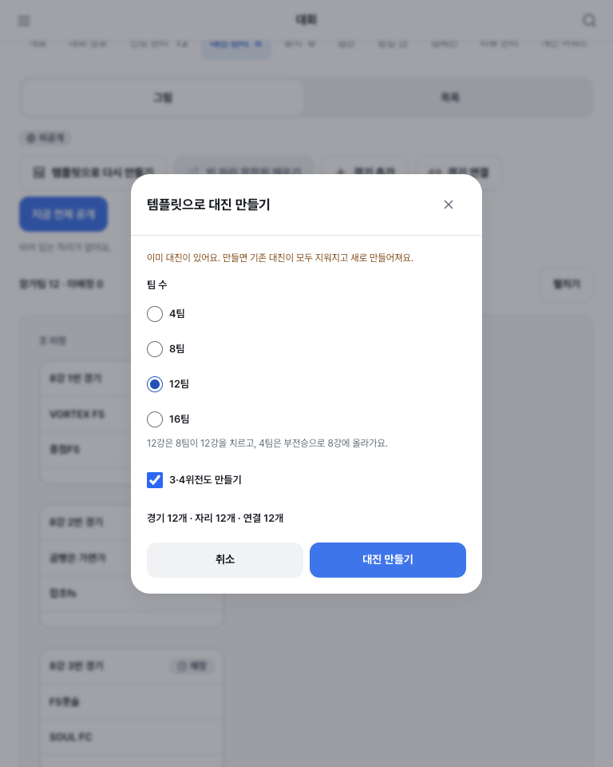
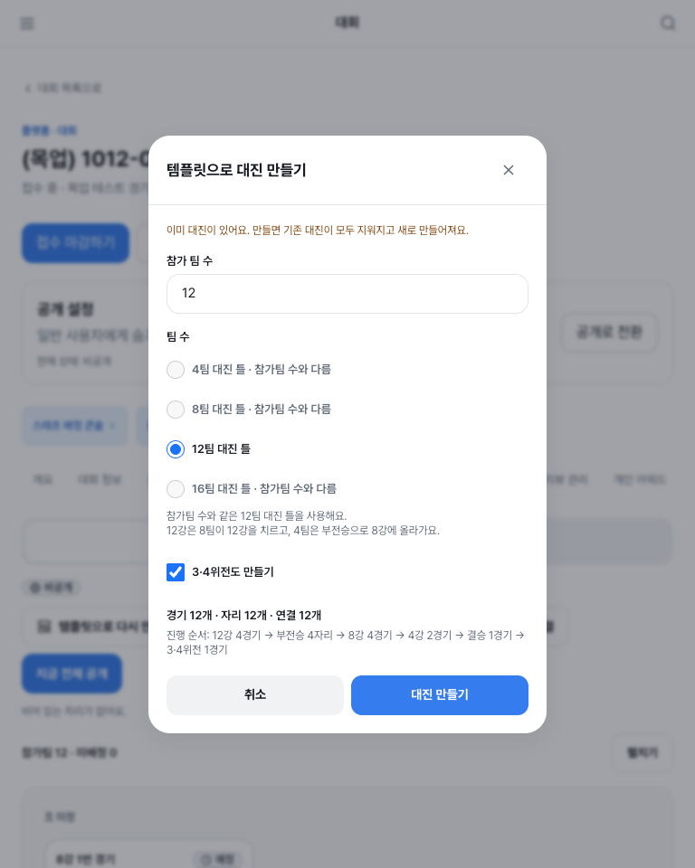
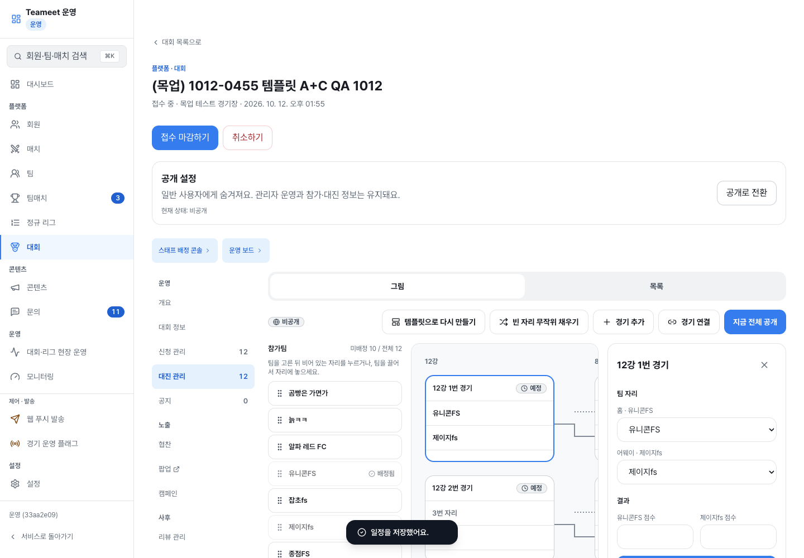
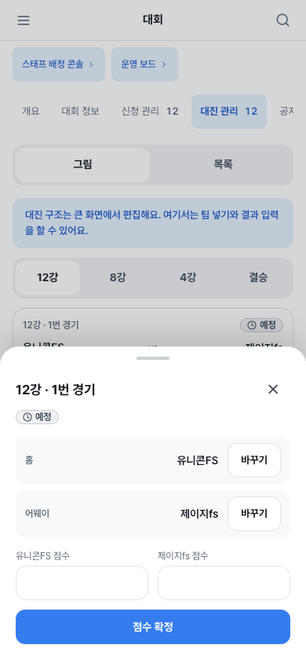

# 템플릿 A+C alpha 검증 — 진행 중

PR [#1853](https://github.com/kim-song-jun/matchup-sports-platform/pull/1853)은 dev에 머지됐다. 배포 SHA는 `c97fe65a5a2902789e173938557f6c58c36b271b`, release는 `1.7.1-alpha.20261012.gc97fe65a5a29`다. 운영자 브라우저 `/api/v1/admin/me` 200과 web/API 배포 헤더를 직접 확인했다.

## 커밋 검증

- 최종 PR head `26f1beab4edc72b15a717eebf6ad2e8429e0516b`와 merge c97의 tree는 동일하다.
- [PR CI 38217790861](https://github.com/kim-song-jun/matchup-sports-platform/actions/runs/38217790861): API/Web/Gates 성공. Web 737 파일·8,684 테스트 통과, 패턴 검사·프로덕션 빌드 성공.
- [dev CI 38219183078](https://github.com/kim-song-jun/matchup-sports-platform/actions/runs/38219183078), [alpha deploy 38219183086](https://github.com/kim-song-jun/matchup-sports-platform/actions/runs/38219183086): 성공.
- 최종 head Copilot open findings 0, 리뷰 thread 7개 모두 resolve. Luna 구현과 Sol 독립 정적 검토를 분리했다.
- 부가 Advanced Security 실행은 기존 dev에서도 실패했다. 로그의 `Model "claude-opus-5" is not available` 때문에 세션 생성이 실패했으며 보안 검사 성공으로 취급하지 않는다.

## 실제 alpha 확인

대상은 이번 작업이 생성한 비공개·결과 없는 QA 엔티티만이다. 다른 대회/리그는 변경하지 않는다.

| 대상 | ID | 확인 상태 |
| --- | --- | --- |
| 단독 12팀 토너먼트 | `1c7cb376-70cf-4532-a95d-3bf088bae1bb` | 768px count 자동 입력, 7팀 생성 차단·이유, 12팀+3·4위전 생성 201 → 첫 경기 편집창, 팀 두 자리 배정, 장소 저장 후 실제 GET 확인 |
| 조별 후 결선 12팀 | `3b62901f-c137-4a76-a97d-7628f81f6fac` | 변경 전 캡처 완료; 배포 후 생성·편집 미검증 |
| 대회 리그 4팀 | `49d8e6f5-a3c3-41e9-bf1c-0f70a44fde3e` | 변경 전 캡처 완료; 배포 후 생성·편집 미검증 |
| 정규 리그 4팀 | `48603613-3382-4993-9106-34661ae74fa6` | 변경 전 캡처 완료; 배포 후 생성·편집 미검증 |

단독 토너먼트 실제 생성 후 GET에서 경기 12개, 자리 12개를 확인했다. 결승 출처 선택에서 반대편에 선택된 준결승이 제외되고, 홈을 비우면 어웨이 후보에 다시 나타나는 것을 실제 DOM에서 확인했다. 이 선택 변경은 저장하지 않았다.

768×960 생성창 경계는 x164/y149.5/w440/h661이며, 닫기·취소·생성 버튼 높이는 모두 44px, 가로 넘침은 없었다. 390×844 모바일 팀·점수 편집창은 가로 넘침이 없고, 닫기·팀 바꾸기·점수 확정 버튼 높이는 44px, 마지막 버튼 하단은 y820으로 화면 안에 있다. 모바일 구조 템플릿 생성이나 일정 편집 기능은 제공되지 않으므로 이를 테스트 완료로 주장하지 않는다. 1440×1000 그림·편집 패널 캡처를 추가했다.

템플릿 생성 이벤트 수집에서는 POST 201, 후속 bracket/detail/registrations GET 200과 console exception/network loading failure 없음이 관측됐다. 전체 QA 세션의 오류가 없었다는 의미는 아니다. 팀·장소 저장은 서버 GET으로 확인했지만 경기 시각은 null이었다. 자동화 입력 문제와 제품 저장 문제를 아직 구분하지 못했으므로 시각 저장은 PASS가 아니다.

## 남은 검증과 환경 제약

- 같은 c97 배포에서 관리자 인증이 다시 401 `UNAUTHENTICATED`로 전환돼 브라우저 제어를 사용자에게 넘겼다. 재인증 전 후속 쓰기 작업을 중단했다. 인증 소실 원인은 확인되지 않았다.
- 남은 실제 검증: 경기 시각 저장, 수기 추가 후 편집·삭제 영향, 조별/대회 리그/정규 리그 생성·편집, 모바일 리그 생성 후 편집과 refetch, 화면 끝까지 스크롤 확인, 역할별 실제 UI.
- 사용자 후속 요청인 그래픽 2×2 템플릿 카드는 로컬 제안만 작성했고 제품 수정은 아직 없다.
- 원래 공유 checkout의 dev FF 동기화는 detached/diverged 상태 때문에 거부됐다. 타 세션 변경을 보존했다. 격리 checkout만 c97로 FF 완료했다.
- 로컬 Next 서버나 Docker를 시작하지 않았다. 이미 끝난 테스트 프로세스와 작업이 만든 dependency symlink는 회수했다. ego space 326은 재인증을 위해 사용자 제어로 유지 중이며 QA 종료 때 `finish({ keep: [] })`가 남아 있다.

## 실제 화면

